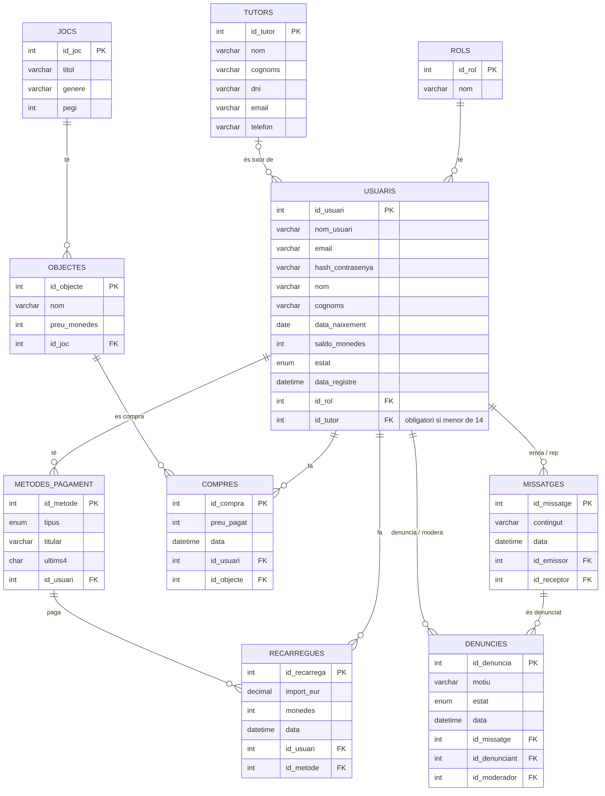

# Plataforma de videojocs online

Projecte de SBD (cas 4): base de dades MySQL per a una plataforma de videojocs on els usuaris compren monedes, gasten les monedes en objectes dels jocs, xategen entre ells i poden denunciar missatges.

## Model entitat-relació



## Estructura del projecte

```
.
├── app/              scripts Python que generen les dades de prova
├── db/               scripts SQL que MySQL executa en ordre en arrencar
├── docs/             documentació (diagrama E-R)
├── backup/           còpies de seguretat
├── compose.yml       serveis de Docker
├── .env.example      plantilla de variables d'entorn
└── requirements.txt  dependències de Python
```

## Posada en marxa

Cal tenir Docker amb Docker Compose.

1. Copiar la plantilla de variables i canviar les contrasenyes:

   ```bash
   cp .env.example .env
   ```

2. Arrencar-ho tot:

   ```bash
   docker compose up -d
   ```

   Primer arrenca el contenidor `app`, que instal·la Faker, executa els scripts de Python i escriu els `.sql` a `db/`. Quan acaba, arrenca MySQL, que la primera vegada executa tots els fitxers de `db/` per ordre numèric: primer crea l'esquema i després hi carrega les dades. Pot trigar una mica.

   Es pot seguir el procés amb `docker compose logs -f`.

3. Connectar-s'hi:

   ```bash
   docker exec -it BBDD_Videojocs mysql -u root -p plataforma_jocs
   ```

   El port 3306 només s'obre a `127.0.0.1`, així que també s'hi pot connectar un client local (DBeaver, Workbench…).

Els scripts de `db/` només s'executen quan el volum és buit. Per tornar a carregar-ho tot des de zero:

```bash
docker compose down -v
docker compose up -d
```

## Esquema

L'esquema és a `db/01_schema.sql`. Taules:

| Taula | Què guarda |
|---|---|
| `rols` | administrador, moderador, auditor i jugador |
| `tutors` | pares o tutors dels usuaris menors de 14 anys |
| `usuaris` | comptes de la plataforma, amb rol, saldo de monedes i tutor si cal |
| `jocs` | títol, gènere i PEGI |
| `objectes` | articles que es poden comprar dins de cada joc |
| `metodes_pagament` | targeta, PayPal o Bizum (de la targeta només els 4 últims dígits) |
| `recarregues` | pagaments en euros que es converteixen en monedes |
| `compres` | objectes comprats amb monedes, amb el preu que es va pagar |
| `missatges` | xat entre usuaris |
| `denuncies` | denúncies de missatges i el moderador que les resol |

Dos triggers (`comprovar_tutor_insert` i `comprovar_tutor_update`) impedeixen que un usuari menor de 14 anys es quedi sense tutor. No es pot fer amb un `CHECK` perquè MySQL no hi deixa fer servir `CURDATE()`.

## Dades de prova

Les dades es generen amb [Faker](https://faker.readthedocs.io/) en castellà (`es_ES`). Els scripts de `app/` no es connecten a MySQL: cadascun escriu un fitxer `.sql` a `db/` i és MySQL qui el carrega en arrencar.

```
app/gen_*.py  ──escriuen──▶  db/*.sql  ──es munta a──▶  MySQL els executa  ──▶  taules plenes
```

Cada script té una llavor fixa, així que tothom obté exactament les mateixes dades si fa servir la mateixa versió de Faker (la de `requirements.txt`) i la mateixa zona horària (UTC), perquè Faker calcula algunes dates a partir de l'hora local. Per això els `.sql` generats també són al repositori: el contenidor `app` els torna a escriure iguals.

| Fitxer SQL | Script | Files | Detalls |
|---|---|---|---|
| `02_tutors.sql` | `generar_dades.py` | 40 | DNI amb lletra correcta |
| `03_usuaris.sql` | `gen_usuaris.py` | 500 | vegeu la taula de rangs d'id |
| `04_jocs.sql` | `gen_jocs.py` | 20 | el PEGI depèn del gènere |
| `05_objectes.sql` | `gen_objectes.py` | 100 | 5 per joc |
| `06_metodes_pagament.sql` | `gen_metodes.py` | 400 | un per jugador adult |
| `07_recarregues.sql` | `gen_recarregues.py` | 800 | 1 € = 100 monedes |
| `08_compres.sql` | `gen_compres.py` | 1500 | només si l'usuari té prou saldo |
| `09_missatges.sql` | `gen_missatges.py` | 3000 | ningú s'envia missatges a si mateix |
| `10_denuncies.sql` | `gen_denuncies.py` | 200 | les fa el receptor del missatge; el 70 % estan resoltes |
| `11_saldos.sql` | — | — | calcula `saldo_monedes` (recàrregues − compres) |

Rangs d'id dels usuaris:

| Ids | Rol | Observacions |
|---|---|---|
| 1–2 | administrador | |
| 3–10 | moderador | resolen les denúncies |
| 11–12 | auditor | |
| 13–440 | jugador | 13–412 tenen mètode de pagament, recàrregues i compres |
| 441–500 | jugador | menors de 14 anys, amb tutor |

### Comprovar que funciona

Després d'arrencar des de zero, les taules han de tenir les files de la taula anterior:

```bash
docker exec -it BBDD_Videojocs mysql -u root -p plataforma_jocs \
  -e "SELECT COUNT(*) FROM usuaris; SELECT COUNT(*) FROM compres; SELECT COUNT(*) FROM missatges;"
```

Ha de sortir 500, 1500 i 3000. I `git diff db/` no ha de mostrar cap canvi, perquè els scripts generen exactament el que hi ha al repositori.

### Generar les dades sense Docker

El contenidor `app` ja ho fa sol, però també es poden executar els scripts en local, des de l'arrel del projecte:

```bash
python -m venv .venv
source .venv/bin/activate
pip install -r requirements.txt

export TZ=UTC
python app/generar_dades.py
python app/gen_usuaris.py
python app/gen_jocs.py
python app/gen_objectes.py
python app/gen_metodes.py
python app/gen_recarregues.py
python app/gen_compres.py
python app/gen_missatges.py
python app/gen_denuncies.py
```

Després cal recrear el volum (`docker compose down -v`) perquè MySQL torni a carregar les dades.
